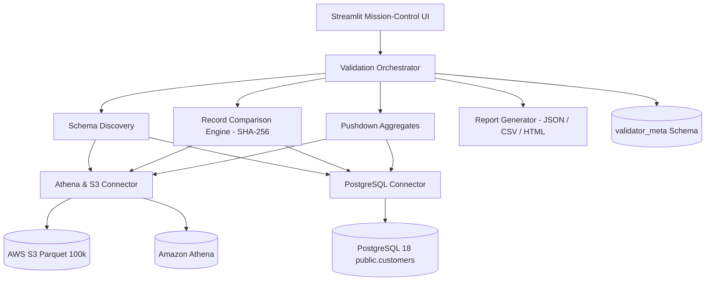

# Enterprise Data Migration Validator

[](https://www.python.org/downloads/)
[](https://streamlit.io/)
[](https://www.postgresql.org/)
[](https://aws.amazon.com/athena/)
[](https://github.com/astral-sh/ruff)
[]()
[](https://duckdb.org/)
[](https://pola.rs/)

An enterprise-grade, high-performance data migration validation application engineered with **Python**, **Streamlit**, **SQLAlchemy 2.x**, **Psycopg 3**, and **boto3**. Compares cloud data lakes (**Amazon S3 + Amazon Athena**) against relational databases (**PostgreSQL 18**) across 100,000+ customer records without loading entire datasets into application memory.

---

## ⚡ Key Capabilities & Features

1. **Pluggable Connector Architecture**: Abstract base connector protocol supporting Amazon Athena, S3 Parquet, and PostgreSQL, designed to easily extend to Snowflake, BigQuery, and Redshift.
2. **Schema Structural & Compatibility Validation**: Compares column names, missing/extra columns, and data type equivalence (Athena `STRING` / `DOUBLE` / `BIGINT` &rarr; PostgreSQL `TEXT` / `DOUBLE PRECISION` / `BIGINT`).
3. **Dynamic Record Count Parity**: Real-time queries executing dynamic counts on both engines.
4. **Business Key Uniqueness & Nullability**: Evaluates primary and composite key uniqueness, detects duplicates, detects NULL keys, and verifies boundary ranges.
5. **Column-Level NULL Parity**: Verifies NULL value counts across mapped columns, explicitly distinguishing NULLs from empty strings `""`.
6. **Pushdown Numeric Aggregates**: Pushes down `SUM`, `AVG`, `MIN`, `MAX`, and `COUNT(DISTINCT)` to the database engine with configurable absolute (`0.01`) and relative (`0.0001`) tolerances.
7. **Record-Level SHA-256 Fingerprint Streaming**: Streams ordered keyset batches to detect missing destination rows, extra destination rows, and pinpoint exact column value divergences.
8. **Isolated Metadata Repository**: Versioned migrations create a dedicated `validator_meta` schema in PostgreSQL, preserving complete audit trails without modifying customer data.
9. **Multi-Format Export Engine**: Downloadable compliance reports in **JSON**, **CSV**, and standalone **HTML** formats with dark styling and executive KPI summaries.
10. **Mission-Control Streamlit UI**: 7-page responsive dark mission-control interface featuring Plotly analytics, live latency meters, and pagination.

---

## 🏗️ System Architecture



---

## 📋 Prerequisites

- **OS**: Windows 10/11 (or Linux / macOS)
- **Python**: Version 3.12 or newer
- **PostgreSQL**: PostgreSQL 18.6+ running locally on port `5432` with database `migration_validator` and table `public.customers`
- **AWS CLI**: AWS CLI v2 with configured profile (`personal-dev`) accessing `s3://loksai-migration-validator-960607644797/`

---

## 🚀 Quickstart & Windows Setup

### 1. Clone & Navigate to Repository
```powershell
git clone <repository_url>
cd "Database Migration"
```

### 2. Configure Environment Variables
Copy the template configuration file:
```powershell
Copy-Item .env.example .env
```
Update `.env` with your PostgreSQL password and AWS profile:
```ini
AWS_PROFILE=personal-dev
AWS_REGION=ap-south-1
ATHENA_DATABASE=migration_validator
ATHENA_WORKGROUP=primary
ATHENA_S3_OUTPUT_LOCATION=s3://loksai-migration-validator-960607644797/Unsaved/
S3_SOURCE_BUCKET=loksai-migration-validator-960607644797
S3_SOURCE_KEY=raw-data/customers/part-000.parquet

POSTGRES_HOST=localhost
POSTGRES_PORT=5432
POSTGRES_DATABASE=migration_validator
POSTGRES_USER=postgres
POSTGRES_PASSWORD=your_postgres_password_here

VALIDATION_BATCH_SIZE=5000
VALIDATION_NUMERIC_TOLERANCE_ABS=0.01
VALIDATION_NUMERIC_TOLERANCE_REL=0.0001
```

### 3. Install Dependencies & Editable Package
```powershell
pip install -r requirements.txt
pip install -e .
```

### 4. Verify Local Environment
```powershell
python scripts/check_environment.py
```

### 5. Initialize Metadata Schema (`validator_meta`)
```powershell
python scripts/initialize_metadata.py
```

### 6. Launch Application (Local Windows Startup)
Using the automated PowerShell launch script:
```powershell
.\scripts\run_local.ps1
```
Or directly with Streamlit:
```powershell
streamlit run app.py
```
Open your browser at **`http://localhost:8501`**.

---

## 🧪 Test Suite & Benchmark Execution

The repository includes a comprehensive 62-test suite covering unit tests, multi-strategy parity, engine pooling, persistent metadata caching, and live end-to-end dataset execution.

```powershell
# Run all offline unit & mock tests (54 tests, zero external dependencies required)
pytest -v

# Run reproducible benchmark suite across 10k, 100k, and 1M records
python benchmarks/benchmark_runner.py --sizes 10000 100000 1000000

# (Optional) Start local PostgreSQL 16 container for live integration testing
docker compose up -d

# Run live integration tests against PostgreSQL and S3 (100,000 records)
pytest -m integration -v -s

# Run Ruff linter and code quality checks
ruff check .
```

---

## 📊 Benchmark Results (100k & 1M Records)

| Dataset Size | Strategy | Runtime | Speedup | Throughput | Peak Memory |
| :--- | :--- | :---: | :---: | :---: | :---: |
| **100,000** | **Baseline Python (Original)** | 54.07 s | 1.0x | 1,854 rows/s | 176.5 MB |
| **100,000** | **Hash-Assisted** | 20.06 s | 2.7x | 4,999 rows/s | 228.6 MB |
| **100,000** | **DuckDB (Production Default)** | **1.28 s** | **42.2x** | **78,168 rows/s** | **191.9 MB** |
| **100,000** | **Vectorized Pandas** | 0.96 s | 56.3x | 104,482 rows/s | 178.2 MB |
| **100,000** | **Polars (SIMD)** | 0.37 s | 145.7x | 269,934 rows/s | 220.2 MB |
| **1,000,000** | **Polars (SIMD)** | 15.81 s | — | 63,429 rows/s | 365.5 MB |
| **1,000,000** | **Vectorized Pandas** | 17.36 s | — | 57,759 rows/s | 333.7 MB |
| **1,000,000** | **DuckDB** | 18.89 s | — | 53,074 rows/s | 358.7 MB |

See [`docs/benchmark-results.md`](docs/benchmark-results.md) for full benchmark logs and methodology.

---

## 📖 Complete Documentation Index

| Document | Description |
| :--- | :--- |
| **[`docs/ARCHITECTURE.md`](docs/ARCHITECTURE.md)** | Mermaid architecture diagrams, data flows, and layer responsibilities |
| **[`docs/REQUIREMENTS.md`](docs/REQUIREMENTS.md)** | Functional and non-functional requirements specification |
| **[`docs/VALIDATION_RULES.md`](docs/VALIDATION_RULES.md)** | Decision matrix and PASS / FAIL / WARNING conditions for all rules |
| **[`docs/SECURITY.md`](docs/SECURITY.md)** | IAM permissions, PostgreSQL roles, secret masking, and read-only queries |
| **[`docs/API_AND_MODULES.md`](docs/API_AND_MODULES.md)** | Class and method reference across connectors, engine, and services |
| **[`docs/PERFORMANCE.md`](docs/PERFORMANCE.md)** | Keyset pagination, memory streaming, Athena cost optimization, and benchmarks |
| **[`docs/TESTING.md`](docs/TESTING.md)** | Pytest execution guide, test fixtures, and synthetic failure datasets |
| **[`docs/TROUBLESHOOTING.md`](docs/TROUBLESHOOTING.md)** | Operational runbook for Windows, Python, PostgreSQL, AWS, and Athena |
| **[`docs/DEPLOYMENT.md`](docs/DEPLOYMENT.md)** | Deployment runbook for Windows, Linux, and Docker containers |
| **[`docs/USER_GUIDE.md`](docs/USER_GUIDE.md)** | End-to-end visual walkthrough of all 7 Streamlit pages |

---

## 🔒 Security & Safe Execution Notice

- **No Credential Logging**: All passwords and secret keys are masked via `pydantic.SecretStr` and filtered out of logs and reports.
- **Read-Only Data Access**: The application issues only `SELECT` queries on customer tables (`public.customers`).
- **SQL Injection Prevention**: Double-quote escaping (`_quote_ident`) and parameterized SQL bind parameters are enforced on all queries.
