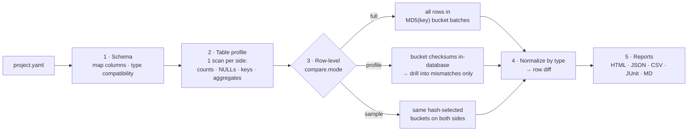

<p align="center">
  
</p>

<p align="center">
  <a href="#quick-start"></a>
  <a href="tests/datavalidator"></a>
  <a href="docs/ARCHITECTURE.md"></a>
  <a href="#ci-cd"></a>
  <a href="https://github.com/astral-sh/ruff"></a>
</p>

<p align="center">
  <b>Check that every migrated table is complete and identical, on any pair of engines,<br/>
  with one YAML file and one command.</b>
</p>

<p align="center">
  <a href="#quick-start">Quick start</a> ·
  <a href="#how-it-works">How it works</a> ·
  <a href="#supported-engines">Engines</a> ·
  <a href="docs/ARCHITECTURE.md">Architecture</a> ·
  <a href="docs/DATAVALIDATOR_GUIDE.md">User guide</a>
</p>

---

## Why dvtool

| Capability | What you get |
|---|---|
| 🧩 **One format for every migration** | Connections and table pairs in YAML. `generate-tables` builds the table list from two schemas and picks up primary keys automatically. |
| 🌏 **Low cross-cloud transfer** | Each database computes per-bucket checksums. Rows cross the network only for buckets that differ. |
| 🎯 **Correct across engines** | Rows are matched by `MD5(key)` instead of `ORDER BY`. Values are compared as typed values (exact decimals, UTC timestamps, NULL ≠ `''`). |
| 🔍 **Complete checks** | Schema & types · row counts · NULL/duplicate keys · NULLs per column · sum/avg/min/max · distinct counts · row-level diff · custom SQL. |
| 🚦 **Ready for CI** | HTML · JSON · CSV · JUnit · Markdown reports, exit codes `0/1/2/3`, Docker image. |
| 🔐 **Safe by default** | Read-only `SELECT`s, secrets from env / AWS Secrets Manager / Alibaba KMS, masked in logs. `dvtool explain` shows all SQL for DBA review. |

## See it run

<p align="center">
  
</p>

## Quick start

```bash
pip install ".[mysql,postgres,aws,alibaba]"        # or ".[all]"

dvtool init migration.yaml                         # commented AWS → Alibaba template
dvtool test-connections -c migration.yaml          # reachability + credentials
dvtool generate-tables  -c migration.yaml --source aws_crm:crm --target ali_crm:crm -o tables.yaml
dvtool explain  -c migration.yaml -t crm.orders    # the exact SQL, for DBA review
dvtool validate -c migration.yaml                  # → dv-reports/<run-id>/report.html
```

A minimal project:

```yaml
project: crm-aws-to-alibaba
connections:
  aws_crm:
    type: aws-aurora-mysql
    host: crm.cluster-ro-xxxx.ap-south-1.rds.amazonaws.com
    database: crm
    user: dv_readonly
    password: ${aws_secret:prod/crm/dv#password}
  ali_crm:
    type: alibaba-polardb-mysql
    host: pc-xxxx.rwlb.singapore.rds.aliyuncs.com
    database: crm
    user: dv_readonly
    password: ${alibaba_kms:prod/crm/dv#password}
    timezone: Asia/Shanghai          # naive timestamps written in UTC+8 on this side

tables:
  - name: customers
    source: {connection: aws_crm, table: crm.customers}
    target: {connection: ali_crm, table: crm.customers}
    # keys: [customer_id]            # optional — primary key is detected
  - name: orders
    source: {connection: aws_crm, table: crm.orders}
    target: {connection: ali_crm, table: crm.orders}
    compare: {mode: profile}         # 500M rows: checksums in-database, fetch only differences
```

More in [`examples/aws_to_alibaba.yaml`](examples/aws_to_alibaba.yaml): Athena → MaxCompute,
PostgreSQL, OSS Parquet, composite keys, renames, partition filters, tolerances and custom SQL checks.

## How it works



**Profile mode** handles large tables. Each engine computes per-bucket counts, NULL counts,
key-weighted numeric and timestamp sums, and an MD5 checksum of every string value. Only these
checksums cross the cloud boundary. Buckets that differ are split 16 ways, again and again, until
they're small enough to fetch:

<p align="center">
  
</p>

In tests, a 300,000-row table with 2 injected differences transferred **4,845 rows** in profile mode
vs **599,999** in full mode, and pinpointed both differences. Weighting each value by its row key
means values **swapped between rows** are caught too, not just changed totals.

Every difference is classified: `MISSING_IN_TARGET` · `EXTRA_IN_TARGET` · `VALUE_MISMATCH` ·
`NULL_MISMATCH` · `DUPLICATE_KEY_SOURCE/TARGET`, with per-column mismatch counts and sample keys.

## Supported engines

| | AWS | Alibaba Cloud |
|---|---|---|
| **MySQL family** | `aws-rds-mysql` · `aws-aurora-mysql` · `aws-rds-mariadb` | `alibaba-rds-mysql` · `alibaba-polardb-mysql` · `alibaba-polardb-x` · `alibaba-adb-mysql` |
| **PostgreSQL family** | `aws-rds-postgres` · `aws-aurora-postgres` · `aws-redshift` | `alibaba-rds-postgres` · `alibaba-polardb-pg` · `alibaba-adb-pg` · `alibaba-hologres` |
| **Lakehouse** | `aws-athena` (Glue over S3) | `alibaba-maxcompute` |
| **Files** | `aws-s3` (Parquet · CSV · JSON) | `alibaba-oss` (Parquet · CSV · JSON) |

Any source works with any target. Generic `mysql`, `postgres`, `duckdb`, `sqlite` and `local-files`
types are also available. Adding an engine takes one `Dialect` class, about 40 lines of SQL building blocks
([how](docs/ARCHITECTURE.md#17-extension-points)).

## CI/CD

```bash
dvtool validate -c migration.yaml --tag critical --fail-on warn
```

| exit | meaning |
|:---:|---|
| `0` | all tables passed |
| `1` | at least one table failed (or warned with `--fail-on warn`) |
| `2` | a table could not be validated (connectivity / SQL error) |
| `3` | invalid configuration |

Each run writes `report.html`, `results.json`, `checks.csv`, `discrepancies.csv`, `junit.xml` and
`summary.md` (added to the GitHub Actions job summary automatically), and appends to `history.jsonl`.
See [`examples/ci/github-actions.yml`](examples/ci/github-actions.yml) and the [`Dockerfile`](Dockerfile).

## Web UI

The same projects can be built and run in a browser. Everything the UI does is a valid
project YAML: export it and `dvtool validate -c` runs it unchanged, or import an existing file.

```bash
pip install ".[all,ui]"
dvtool ui                           # http://localhost:8501
dvtool ui -c migration.yaml --port 8502
```

| Screen | What you do |
|---|---|
| Project | New / import / export YAML; name, parallel tables, report directory |
| Connections | Add any engine type, test it, duplicate it for a second account or region |
| Tables | Discover tables on both sides, auto-pair by name, pair renamed tables, set keys, filters, renames, tags |
| Checks & options | Project defaults and per-table overrides: checks, compare mode, tolerances, normalization, custom SQL |
| Review SQL | The exact SQL each side will run, with a cost warning for engines billed per data scanned |
| Run | Background run with live per-table progress and cancel |
| Results · History | PASS/FAIL per table and check, filterable discrepancies, report downloads, past runs |

Any type can be paired with any type, including the same one on both sides (Athena → Athena
across two accounts). Engine lists and connection forms are generated from the engine's
metadata, so a new engine shows up in the UI without UI changes. Typed secrets stay in the
browser session; export converts them to `${env:VAR}` references and never writes them to a file.
Full walkthrough in the [user guide](docs/DATAVALIDATOR_GUIDE.md#12-web-ui).

## Documentation

| Document | What's inside |
|---|---|
| [**Architecture**](docs/ARCHITECTURE.md) | Context & deployment topologies, components, runtime sequence, bucket/checksum algorithms, data model, dialects, concurrency, security, cost model, design decisions |
| [**User guide**](docs/DATAVALIDATOR_GUIDE.md) | Install, every config option, AWS ⇄ Alibaba pitfalls (time zones, MaxCompute full scans, Athena cost, whitelists, IAM/RAM), migration runbook |
| [**v1 code review**](docs/CODE_REVIEW_V1.md) | Issues found in the original engine and how v2 addresses them |
| [Legacy docs](docs/legacy/) | The original Streamlit Athena → PostgreSQL app |

## Project layout

```text
src/datavalidator/          engine + CLI (dvtool)
├── cli.py                  init · test-connections · discover · generate-tables · explain · validate
├── config.py  secrets.py   YAML model, connection types, ${env|file|aws_secret|alibaba_kms}
├── runner.py  engine.py    parallel tables · schema → profile → row diff → custom checks
├── dialects.py             mysql · postgres · redshift · hologres · athena · maxcompute · duckdb · sqlite
├── connectors.py executors.py   catalogs · DB-API pool · Athena (S3 CSV) · MaxCompute (Tunnel)
├── normalize.py compare.py datatypes.py   type-aware normalization and row diff
├── reports.py models.py    HTML · JSON · CSV · JUnit · Markdown
├── workspace.py jobs.py discovery.py project_io.py ui_schema.py   what the web UI calls
└── ui/                     Streamlit web UI (dvtool ui)
tests/datavalidator/        96 tests · SQLite end-to-end · emulated Athena / MaxCompute / MySQL · UI
examples/                   AWS → Alibaba project, GitHub Actions workflow
docs/                       architecture, guide, animated assets
app.py · pages/ · src/migration_validator/   legacy Athena → PostgreSQL UI (separate)
```

## Development

```bash
pip install -e ".[all,dev]"
pytest tests/datavalidator        # no external services required
ruff check src/datavalidator tests/datavalidator
```

The cross-engine tests run the real Athena and MaxCompute executors and the generated
Athena / MaxCompute / MySQL SQL against SQLite-backed emulations. Before relying on a new engine
pairing in production, do a pilot run on a small table with known injected differences.

<details>
<summary><b>Legacy Streamlit UI</b></summary>

The original app (`app.py`, `pages/`, `src/migration_validator`) validates Athena/S3 → PostgreSQL
for a `customers`-style table. It still runs with `pip install ".[ui]"` then `streamlit run app.py`.
Its docs are in [`docs/legacy`](docs/legacy/). Moving the UI onto the new engine is planned.
</details>
