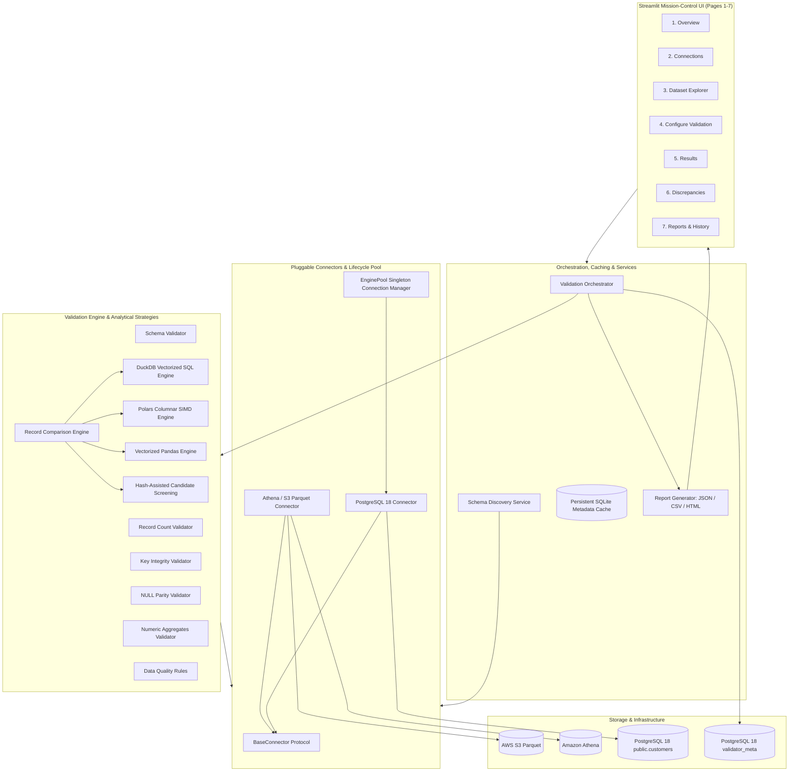

# System Architecture & Component Design

## 1. High-Level Architecture Overview

The **Data Migration Validator** is an enterprise-grade validation framework designed to verify data parity, schema alignment, and semantic consistency between cloud data lakes (**Amazon Athena + Amazon S3**) and relational destinations (**PostgreSQL**).

---

## 2. Logical Components and Responsibilities

### 2.1. Connectors Layer (`src/migration_validator/connectors/`)
- **`BaseConnector` (ABC)**: Defines the standard connector contract. Any future relational database or data warehouse (Snowflake, BigQuery, Redshift, MySQL) can be plugged in by implementing this protocol.
- **`PostgresConnector`**: Connects via SQLAlchemy 2.x and Psycopg 3 (`postgresql+psycopg://`). Performs read-only queries, SQL identifier escaping, aggregate pushdowns, and keyset pagination.
- **`AthenaConnector`**: Uses `boto3` to communicate with AWS Athena and S3. Features dual-mode execution:
  1. Standard Athena execution via `start_query_execution`.
  2. High-performance S3 Direct Parquet stream execution when Athena API access is constrained by IAM policies.

### 2.2. Validation Engine (`src/migration_validator/validation/`)
- **`schema.py`**: Compares column existence, data type compatibility (e.g. `string` -> `text`, `bigint` -> `bigint`, `double` -> `double precision`), and structural alignment.
- **`counts.py`**: Dynamically queries source and destination record counts.
- **`keys.py`**: Evaluates primary and composite key uniqueness, duplicate key detection, null keys, and boundary parity (`MIN(key)` and `MAX(key)`).
- **`nulls.py`**: Validates NULL distributions column-by-column, explicitly differentiating `NULL` from empty strings `""`.
- **`aggregates.py`**: Pushes down `SUM`, `AVG`, `MIN`, `MAX`, and `COUNT(DISTINCT)` calculations. Evaluates differences using absolute (`tolerance_abs`) and relative (`tolerance_rel`) thresholds.
- **`serialization.py`**: Implements deterministic canonical serialization:
  - Canonical NULL sentinel: `\x00__VALIDATOR_NULL__\x00`.
  - Float normalization to 4 decimal places.
  - ISO-8601 UTC timestamps without microsecond jitter.
  - Deterministic column sorting.
  - Canonical UTF-8 representation hashed with SHA-256.
- **`record_comparison.py`**: Streams records in ordered keyset batches (e.g., 5,000–10,000 records). Compares record-level SHA-256 fingerprints and pinpoints column differences.
- **`quality.py`**: Evaluates data anomalies (such as duplicate emails) as advisory data quality rules without falsely failing migration infrastructure.

### 2.3. Services & Persistence
- **`orchestration.py`**: Drives the execution lifecycle, records checkpoints, aggregates discrepancies, computes overall run statuses, and records all telemetry into `validator_meta`.
- **`metadata_repository.py`**: PostgreSQL repository isolating all run records, check results, and discrepancies in the `validator_meta` schema.
- **`reports/`**: Generates JSON compliance reports, CSV discrepancy exports, and standalone executive HTML summaries.
