# Architecture — datavalidator (`dvtool`)

End-to-end architecture of the cross-cloud migration validation engine: context, deployment,
components, runtime flow, algorithms, data model, security, performance and extension points.

> Scope: the v2 engine in `src/datavalidator`. The legacy Streamlit UI (`app.py`, `pages/`,
> `src/migration_validator`) is described in [`legacy/ARCHITECTURE.md`](legacy/ARCHITECTURE.md).

**Contents**
1. [Goals and constraints](#1-goals-and-constraints)
2. [System context](#2-system-context)
3. [Deployment topologies](#3-deployment-topologies)
4. [Component architecture](#4-component-architecture)
5. [Module map](#5-module-map)
6. [Runtime: one `dvtool validate` run](#6-runtime-one-dvtool-validate-run)
7. [Table validation pipeline](#7-table-validation-pipeline)
8. [Core algorithms](#8-core-algorithms)
9. [Data model](#9-data-model)
10. [Dialect layer](#10-dialect-layer)
11. [Execution layer](#11-execution-layer)
12. [Concurrency model](#12-concurrency-model)
13. [Status semantics and error handling](#13-status-semantics-and-error-handling)
14. [Security architecture](#14-security-architecture)
15. [Performance and cost model](#15-performance-and-cost-model)
16. [Observability and outputs](#16-observability-and-outputs)
17. [Extension points](#17-extension-points)
18. [Test architecture](#18-test-architecture)
19. [Design decisions](#19-design-decisions)

---

## 1. Goals and constraints

| Goal | How the architecture meets it |
|---|---|
| **Reusable across migrations** | Everything project-specific lives in one YAML file; no per-table code. Columns, keys and numeric types come from catalogs. |
| **Any source ⇄ any target** | Every check is written once against a small `Dialect` interface; engines differ only in ~40 lines of SQL building blocks. |
| **Correct across engines** | Rows are matched by `MD5(key)` hash buckets (not `ORDER BY`), and values are normalized by logical type before comparison. |
| **Low cross-cloud egress** | Aggregates and checksums are computed *inside* each engine; rows are fetched only where checksums differ. |
| **Bounded memory** | Row fetches are cut into bucket batches of `fetch_batch_rows`; nothing loads a whole table. |
| **CI/CD-native** | Deterministic exit codes, JUnit/JSON/HTML/Markdown reports, no interactive steps. |
| **Least privilege** | Read-only `SELECT`s only, secrets resolved at runtime and masked in logs. |

**Constraints:** engines on both clouds are reachable only over the network (often a VPN or
dedicated line with limited bandwidth). Lakehouse engines (Athena, MaxCompute) bill per scan.
OLTP sources may be production databases, so queries must be predictable and reviewable
(`dvtool explain`).

---

## 2. System context

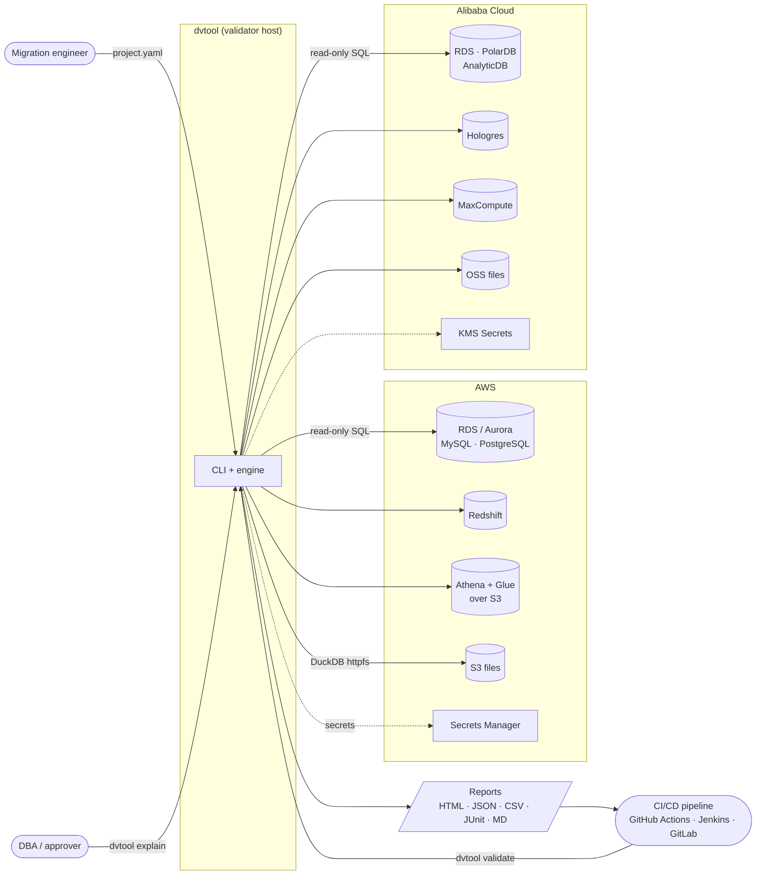

The validator is a stateless process. Its only state is the project file it reads and the report
directory it writes. It never writes to source or target systems.

---

## 3. Deployment topologies

The validator host needs network reach to **both** clouds. Pick the location that keeps the heavy
path (row fetches during drill-down / full mode) short.

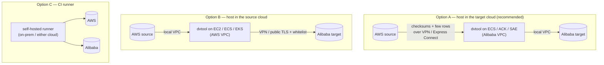

| Network element | AWS side | Alibaba side |
|---|---|---|
| Private connectivity | Site-to-Site VPN, Transit Gateway | VPN Gateway, Express Connect, CEN |
| Database access control | Security group inbound rule | RDS / PolarDB **IP whitelist** |
| TLS | `ssl: true` / `sslmode: verify-full` | `ssl: true` |
| Lakehouse endpoints | Athena regional endpoint, S3 | MaxCompute service + Tunnel endpoints, OSS |

Packaging: `pip install ".[extras]"` or the `Dockerfile` image (non-root user, `ENTRYPOINT dvtool`).

---

## 4. Component architecture

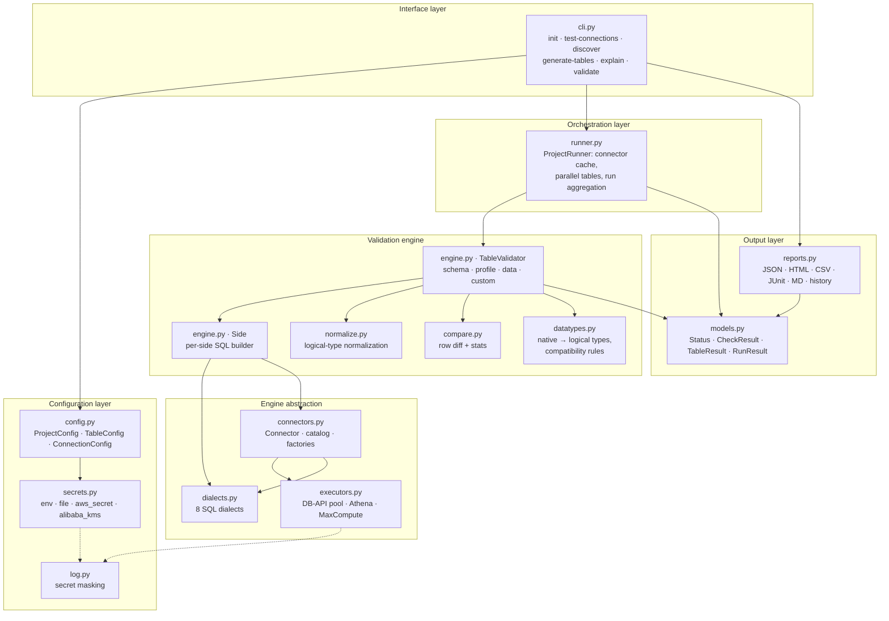

Dependency rule: arrows point downwards only. The engine never imports the CLI or report
modules, and dialects have no I/O. Every query goes through `Connector.query()`, which keeps
testing and tracing in one place.

---

## 5. Module map

| Module | Responsibility | Key types / functions |
|---|---|---|
| `cli.py` | Commands, progress output, exit codes, GitHub job summary | `main`, `validate`, `explain`, `generate_tables` |
| `config.py` | YAML loading, `include:`, deep-merge of `defaults`, validation, friendly connection types | `load_project`, `ProjectConfig`, `TableConfig`, `CONNECTION_TYPES` |
| `secrets.py` | `${scheme:ref}` resolution with lazy SDK imports | `resolve`, `RESOLVERS` |
| `log.py` | Logger factory with masking filter (registered secrets, URL passwords, `key=value`) | `get_logger`, `register_secret`, `mask` |
| `runner.py` | One connector per connection (shared), thread pool over tables, run status | `ProjectRunner`, `select_tables` |
| `engine.py` | The validation pipeline for one table pair | `TableValidator`, `Side`, `Pair` |
| `datatypes.py` | Native type parsing, logical types, compatibility verdicts | `parse_type`, `Logical`, `check_compatibility` |
| `normalize.py` | Canonical values per logical type, time-zone handling | `normalize_series`, `comparison_logical` |
| `compare.py` | Key alignment, duplicates, missing/extra, per-column diffs, samples | `compare_frames`, `ColumnSpec`, `CompareStats` |
| `dialects.py` | SQL building blocks and catalog SQL per engine family | `Dialect`, `get_dialect`, `NULL_SENTINEL` |
| `executors.py` | Run SQL, return `DataFrame(dtype=object)`, retries | `DbApiExecutor`, `AthenaExecutor`, `MaxComputeExecutor` |
| `connectors.py` | Catalog discovery, PK detection, dataset `FROM`, driver factories | `Connector`, `MaxComputeConnector`, `create_connector` |
| `models.py` | Serializable result model and status ordering | `Status`, `CheckResult`, `Discrepancy`, `TableResult`, `RunResult` |
| `reports.py` | Report writers and `history.jsonl` | `write_all`, `write_html`, `write_junit` |

---

## 6. Runtime: one `dvtool validate` run

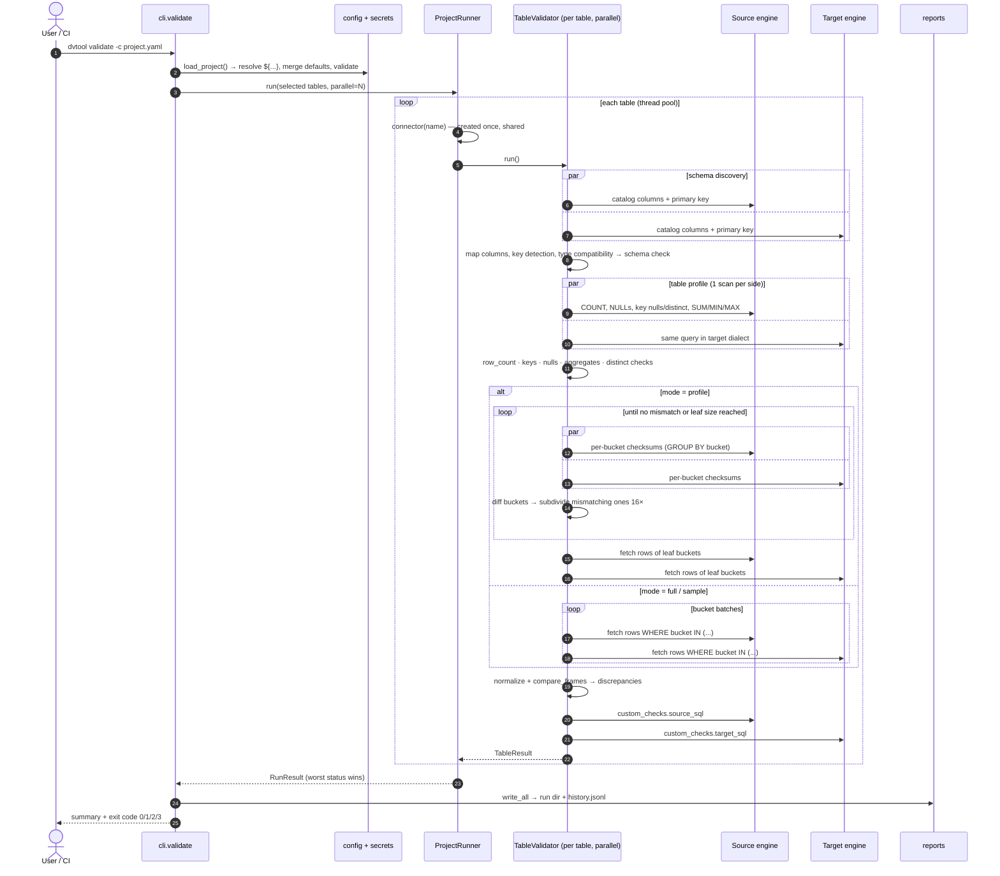

---

## 7. Table validation pipeline

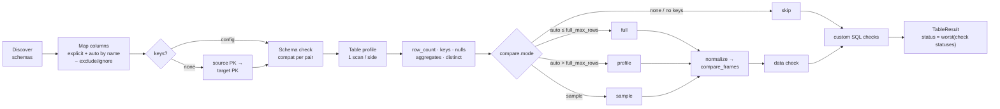

Column pairing produces one `Pair` per mapped column. Each pair holds the source and target
`ColumnInfo`, the **comparison logical type** (`comparison_logical(src, tgt)`), whether it is a key,
and whether temporal checksums are allowed (both zones have a constant UTC offset).

---

## 8. Core algorithms

### 8.1 Hash bucketing

```
key_text  = CAST(k AS text)                         -- single key
          | CAST(k1 AS text) || '|' || CAST(k2 AS text) ...   -- composite (dialect concat)
          | bucket_key_expr                         -- per-side override
bucket(L) = SUBSTR(MD5(key_text), 1, L)             -- L hex digits → 16^L buckets
```

* The expression is evaluated by each engine on its own data. MD5 is a standard function, so a
  given key lands in the same bucket on both sides regardless of collation, sort order, physical
  layout or partitioning.
* Rows with a NULL key component are excluded from bucket and fetch queries and reported by the
  `keys` check instead.
* MD5 output is uniform, so every bucket holds about `N / 16^L` rows. That makes batch sizes and
  sample fractions predictable.

### 8.2 Table profile (one scan per side)

```sql
SELECT COUNT(*)                                        AS dv_rows,
       SUM(CASE WHEN k IS NULL ... THEN 1 ELSE 0 END)  AS dv_null_keys,
       COUNT(DISTINCT k | key_text)                    AS dv_distinct_keys,
       COUNT(c_i)                                      AS n_i,     -- every mapped column
       SUM(c_i), MIN(c_i), MAX(c_i)                    AS s_i, mn_i, mx_i   -- numeric
       MIN(t_i), MAX(t_i)                              AS mn_i, mx_i        -- temporal
       COUNT(DISTINCT d_i)                             AS d_i      -- distinct_columns
FROM <table or (query)> [WHERE filter]
```

Derived: `nulls_i = dv_rows − n_i`, `duplicates = dv_rows − dv_null_keys − dv_distinct_keys`,
`avg_i = s_i / n_i`. Numerics are compared as `Decimal` with `|a−b| ≤ abs_tol ∨ ≤ rel_tol·max(|a|,|b|)`.
Temporal MIN/MAX go through the same normalizer as row values.

### 8.3 Profile mode: recursive checksum drill-down

Per bucket, each engine returns:

| metric | expression | catches |
|---|---|---|
| `dv_rows` | `COUNT(*)` | missing / extra rows |
| `n_i` | `COUNT(c_i)` | NULL ↔ value changes |
| `s_i` numeric / boolean | `SUM(c_i × w)` | value changes, swaps |
| `h_i` string | `SUM(hex7(MD5(key_text ‖ '|' ‖ c_i)))` (NULL-guarded) | any text change, swaps |
| `e_i`, `w_i` temporal | `SUM(epoch(c_i) × w)`, `SUM(w)` over non-NULL | timestamp shifts, swaps |

`w = hex2(SUBSTR(MD5(key_text), 9, 2)) + 1 ∈ [1, 256]` is a per-row weight taken from the key.
With plain `SUM(c)`, two rows in one bucket exchanging values give the same total. Weighting
each value by its own key makes that change visible.

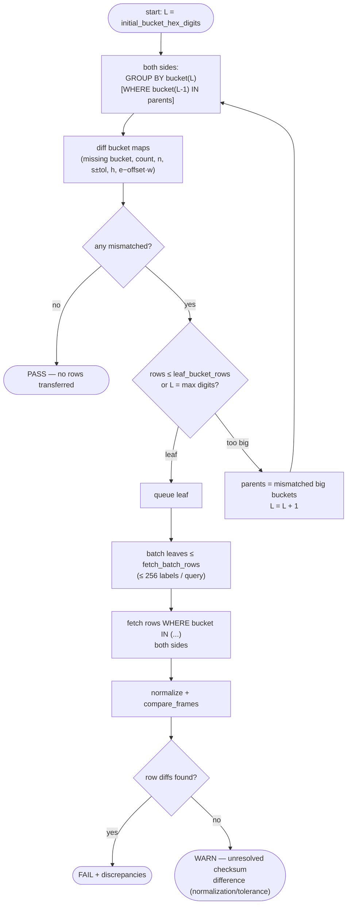

**Time-zone correction.** Engines compute `epoch()` from the stored wall-clock value. For a column
stored as naive time in zone `Z` with constant offset `o_Z` seconds:
`Σ epoch_utc·w = Σ epoch_wall·w − o_Z · Σ w`. Both sides are corrected before comparing, so an
AWS column in UTC and an Alibaba column in `Asia/Shanghai` compare equal. Columns that are
tz-aware (`timestamptz`, MySQL `TIMESTAMP` in a `+00:00` session) use `o = 0`. Zones with DST
are excluded from temporal checksums and checked during row comparison.

**Tolerance scaling.** A per-row absolute tolerance `abs_tol` becomes `abs_tol · 256 · n` on a
weighted bucket sum. Float columns use a relative tolerance (`float_rel`).

### 8.4 Full and sample modes

```
if N ≤ fetch_batch_rows:          one fetch per side (no bucket filter)
else:  L = smallest digits with N / 16^L ≤ fetch_batch_rows
       labels = all 16^L prefixes                      (full)
              | first ⌈16^L · pct/100⌉ of md5-shuffled (sample, L ≥ 2)
       batches of ⌊fetch_batch_rows / (N/16^L)⌋ labels (≤ 256)
```

Sampling by key hash means both sides sample **exactly the same keys**. `ORDER BY RAND()` or
`TABLESAMPLE` would pick different rows on each engine.

### 8.5 Normalization and row comparison

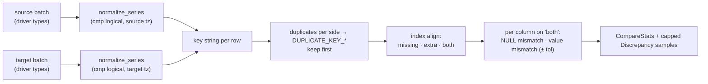

| Comparison logical | Canonical form |
|---|---|
| integer / decimal | `Decimal` (exact, 64-bit safe), tolerance optional |
| float | `float`, relative tolerance |
| timestamp / timestamp_tz | UTC string truncated to `s` / `ms` / `us`; naive values localized with the side's `timezone` |
| date | `YYYY-MM-DD` |
| boolean | `true` / `false` from bool, 0/1, `t/f`, `yes/no` |
| json / complex | compact JSON with sorted keys |
| binary | lower-case hex |
| string | text with optional trim / rtrim / lower / empty-as-NULL |

Unparsable values become `<unparsable:…>` so they show up as mismatches rather than NULLs.

### 8.6 Type compatibility (schema check)

`parse_type(native, engine)` maps native types to logical types, including engine quirks: MySQL
`tinyint(1)` → boolean, MySQL `TIMESTAMP` → timestamp_tz, Athena `timestamp(3)`, MaxCompute
`DATETIME`, complex `array<…>`/`map<…>`. `check_compatibility` returns `ok` / `warn` / `fail`:
same family with no narrowing passes; widening passes; varchar length, decimal scale or
integer-digit shrink **fails**; tz semantics changes, decimal→float and anything→string **warn**.

---

## 9. Data model

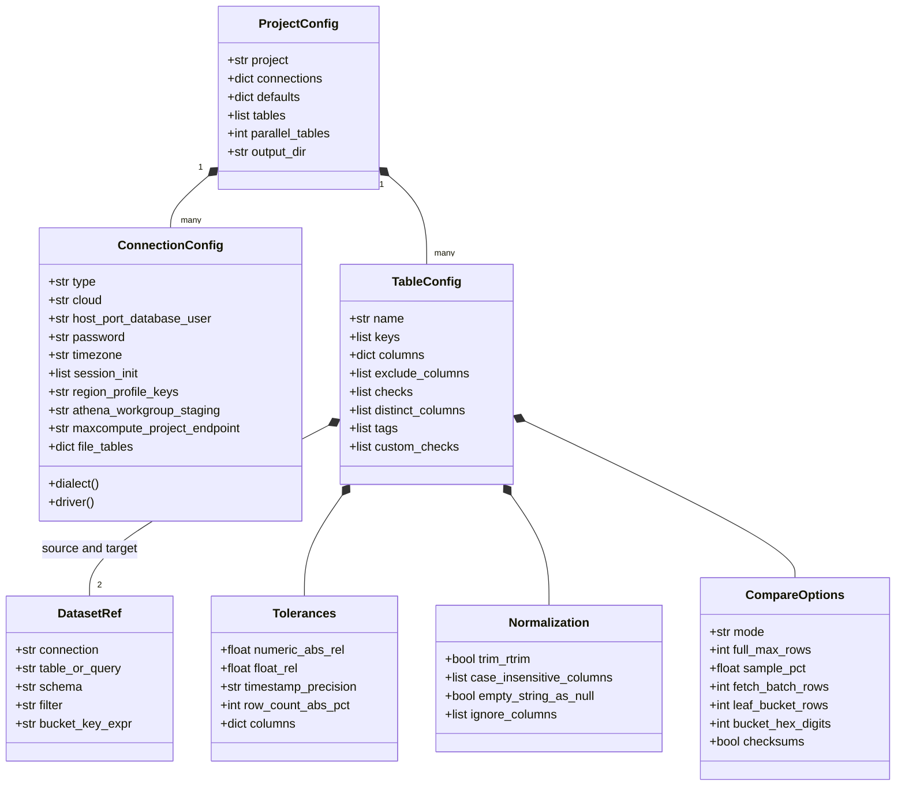

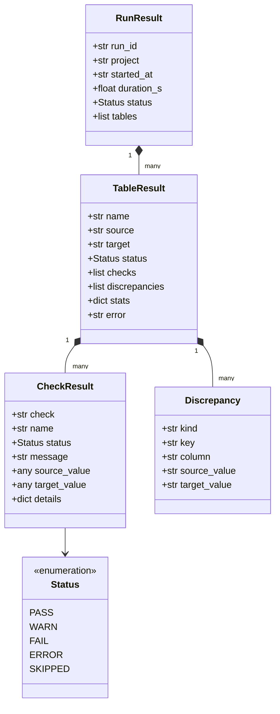

`TableResult.stats` records: resolved keys and where they came from, row counts, queries issued,
and rows fetched per side (the egress measure).

---

## 10. Dialect layer

All validation SQL is built from these primitives:

| Primitive | postgres | redshift | hologres | mysql | athena | maxcompute | duckdb | sqlite |
|---|---|---|---|---|---|---|---|---|
| quote | `"x"` | `"x"` | `"x"` | `` `x` `` | `"x"` | `` `x` `` | `"x"` | `"x"` |
| text cast | `TEXT` | `TEXT` | `TEXT` | `CHAR` | `VARCHAR` | `STRING` | `VARCHAR` | `TEXT` |
| concat | `\|\|` | `\|\|` | `\|\|` | `CONCAT()` | `\|\|` | `CONCAT()` | `\|\|` | `\|\|` |
| md5 hex | `md5()` | `md5()` | `md5()` | `MD5()` | `lower(to_hex(md5(to_utf8())))` | `MD5()` | `md5()` | UDF |
| hex → int | `('x'‖h)::bit(n)::int` | `STRTOL(h,16)` | positional `STRPOS` | `CONV(h,16,10)` | `from_base(h,16)` | `CONV(h,16,10)` | positional | UDF |
| epoch | `EXTRACT(EPOCH …)` | same | same | `TIMESTAMPDIFF(SECOND …)` | `to_unixtime()` | `DATEDIFF(…,'ss')` | `epoch()` | `strftime('%s')` |
| catalog | `pg_attribute` + `format_type` | same | same | `information_schema.COLUMN_TYPE` | `information_schema` | PyODPS API | `information_schema` | `pragma_table_info` |
| PK | `pg_index` | — | — | `key_column_usage` | — | — | — | `pragma` |

Session setup: MySQL family `SET time_zone = '+00:00'`. PostgreSQL family `SET TIME ZONE 'UTC'`
and `statement_timeout`. MaxCompute always enables the ODPS 2.0 type system hints.

---

## 11. Execution layer

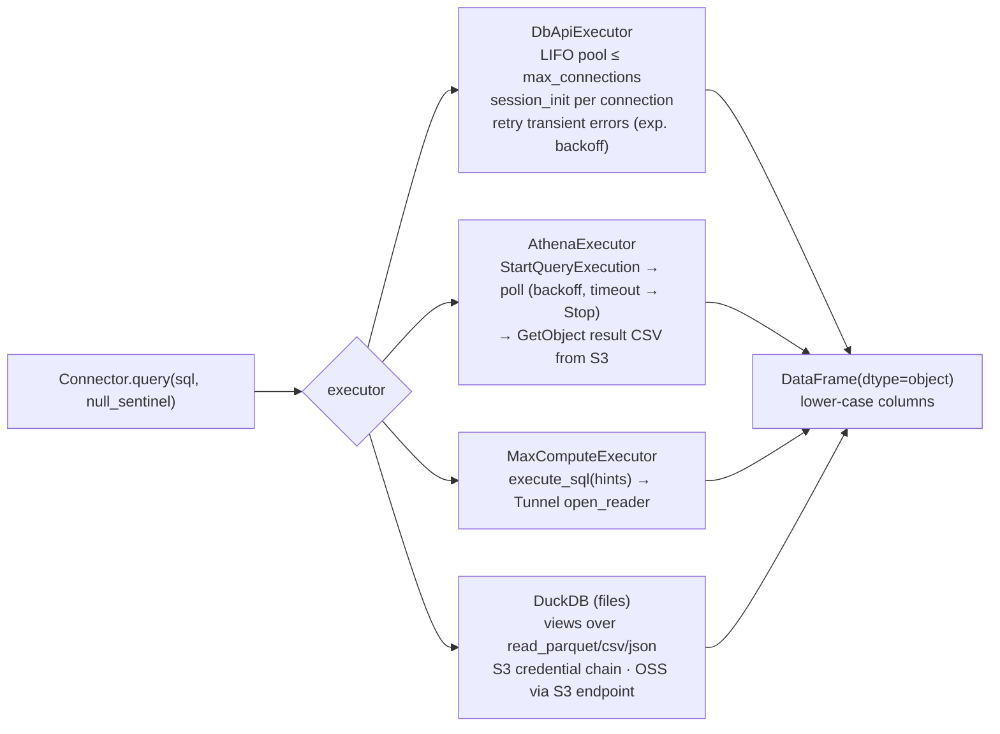

* **`dtype=object` everywhere.** pandas would otherwise turn a NULL-containing `BIGINT` column
  into `float64` and lose precision above 2^53.
* **Athena NULLs.** Athena's CSV output can't tell NULL from an empty string. Row-fetch queries
  wrap each column as `COALESCE(CAST(c AS VARCHAR), '\u0001__DV_NULL__\u0001')` and the executor
  maps the sentinel back to `None`. Aggregate queries treat an empty field as NULL.
* **Retries** cover transient conditions only: dropped connections, throttling, too many
  connections. A broken pooled connection is discarded and recreated.

---

## 12. Concurrency model

```
ProjectRunner ── ThreadPoolExecutor(parallel_tables) ──► TableValidator × N
TableValidator ── ThreadPoolExecutor(2) ──► source query ∥ target query
Connector (one per connection, shared) ── DbApiExecutor pool (max_connections)
```

* The source and target query for each step always run in parallel, so wall time is roughly
  the slower engine's time, not the sum of both.
* Connection pools cap concurrent load on each engine: worst case is
  `min(parallel_tables, max_connections)` queries per engine.
* Results are aggregated after `as_completed`, then re-ordered to project order so reports are
  deterministic.

---

## 13. Status semantics and error handling

| Status | Meaning | Examples |
|---|---|---|
| `PASS` | Check ran, no difference beyond tolerances | |
| `WARN` | Ran; difference that may be acceptable | tz semantics change, extra target column, unresolved bucket checksum |
| `FAIL` | Ran; data or structure differs | missing rows, value mismatch, varchar shrink |
| `ERROR` | Could not run | connectivity, missing table, SQL error, driver not installed |
| `SKIPPED` | Not applicable | no keys for `data`, `mode: none` |

Table status = worst check status. Run status = worst table status (ranking: `ERROR > FAIL >
WARN > PASS > SKIPPED`). A failure in one table never stops the others. CLI exit codes:
`0` pass, `1` fail (or warn with `--fail-on warn`), `2` error, `3` configuration error.

---

## 14. Security architecture

| Concern | Control |
|---|---|
| Credentials at rest | Never in YAML. `${env:}`, `${file:}`, `${aws_secret:id#key}`, `${alibaba_kms:name#key}` resolved at load time |
| Credentials in logs | Resolved secrets registered with a masking filter. URL passwords and `password=` / `secret=` patterns masked in every log record |
| Least privilege | Only `SELECT` and session `SET`; `dvtool explain` prints all SQL for approval |
| SQL injection | Identifiers quoted per dialect with escaping. Literals escaped, including MySQL backslashes. `filter` / `query` / `custom_checks` are trusted config, the same trust level as the project file |
| Transport | TLS options per connection; private connectivity recommended (section 3) |
| Reports | HTML is auto-escaped (Jinja2). Discrepancy samples contain data values, so store reports with the same classification as the data, or set `max_discrepancy_samples: 0` |
| Container | Non-root user, no secrets baked into the image |

---

## 15. Performance and cost model

Let `N` = rows, `B = fetch_batch_rows`, `D` = differing rows.

| Mode | Queries per side | Rows transferred per side | Engine work |
|---|---|---|---|
| profile (no diffs) | 1 profile + 1 bucket level | 0 | 2 scans |
| profile (D diffs) | 1 + levels (≈1–3) + ⌈leaf rows / B⌉ | ≈ D × leaf size (≤ `leaf_bucket_rows` each) | 1 + levels scans |
| full | 1 + ⌈N / B⌉ | N | 1 + ⌈N/B⌉ filtered scans |
| sample p% | 1 + ⌈pN / B⌉ | ≈ pN | 1 + batches |

* **Athena / MaxCompute** bill per bytes scanned. Use partition `filter`s; profile mode keeps
  scans to about 2–4 per table.
* **OLTP sources:** bucket queries are full scans with `GROUP BY`. Run them against read replicas
  (`cluster-ro` endpoints) and limit concurrency with `parallel_tables` / `max_connections`.
* **Validator CPU:** normalization and comparison run at roughly 30–50k rows/s per side per
  table thread. Use profile mode for anything large.

Measured on SQLite (MD5 runs as a Python UDF there, so engine-side times are pessimistic):
300k rows with 2 injected differences → profile transferred 4,845 rows vs 599,999 in full mode.

---

## 16. Observability and outputs

```
dv-reports/
├── history.jsonl                 # one line per run: id, status, per-table status (trend tracking)
└── <run_id>/
    ├── results.json              # complete RunResult (machine readable)
    ├── report.html               # self-contained report, failed tables expanded
    ├── checks.csv                # one row per check
    ├── discrepancies.csv         # sampled row-level differences
    ├── junit.xml                 # table = testsuite, check = testcase
    └── summary.md                # also appended to $GITHUB_STEP_SUMMARY
```

Logs: `--log-level DEBUG` prints every SQL statement (truncated), row counts and timings per query.

---

## 17. Extension points

| To add… | Change | Size |
|---|---|---|
| A new engine (e.g. Oracle, SQL Server, Snowflake) | `Dialect` subclass + factory in `create_connector` + entries in `CONNECTION_TYPES` | ~60–100 lines |
| A new secret backend | function in `secrets.RESOLVERS` | ~20 lines |
| A new check | method on `TableValidator`, name in `ALL_CHECKS` | varies |
| A new report format | writer in `reports.write_all` | ~30 lines |
| A file format | entry in the DuckDB reader map in `_files_connector` | 1 line |

---

## 18. Test architecture

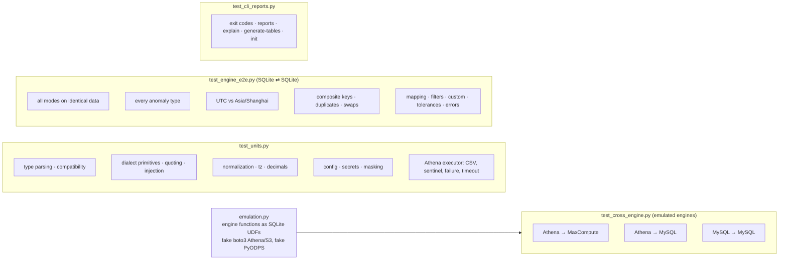

The emulation layer runs the **real** Athena and MaxCompute executors and the **real** generated
dialect SQL. It already caught one cross-engine semantic difference (`CONCAT` with NULL), now
guarded explicitly. PostgreSQL-specific SQL (`::bit(n)`) is covered by inspection and unit
tests only; validate it with a pilot run on a real instance.

---

## 19. Design decisions

| # | Decision | Alternatives considered | Rationale |
|---|---|---|---|
| D1 | Hash buckets `SUBSTR(MD5(key))` for alignment | Keyset pagination with `ORDER BY` | Collations and sort orders differ across engines and cause false missing/extra rows. Buckets are order-free and partition naturally |
| D2 | In-database checksums + drill-down | Pull everything and compare | Cross-cloud bandwidth and egress cost. Checksums are a few KB per level |
| D3 | Key-weighted sums | Plain column sums; full row-text hash | Plain sums miss swaps. Hashing a whole row's text depends on each engine's number/timestamp formatting. Weighted numeric sums + per-string MD5 avoid both problems |
| D4 | Normalize by logical type in Python | Cast everything to text in SQL | Text formatting of decimals, floats and timestamps differs per engine. Typed normalization is exact and handles time zones |
| D5 | One profile query per side | One query per check | One scan instead of five or more; matters for Athena/MaxCompute billing |
| D6 | Thin DB-API executors, lazy drivers | SQLAlchemy for everything | Fewer dependencies per project; Athena/MaxCompute aren't SQLAlchemy-native anyway |
| D7 | Unresolved checksum difference → `WARN` | `FAIL` | If the row-level diff finds nothing, the cause is usually normalization or tolerance. Flag it without blocking |
| D8 | YAML + CLI as the primary interface | UI-first | Repeatable, reviewable in PRs, runs in CI; a UI can be layered on the same engine |
